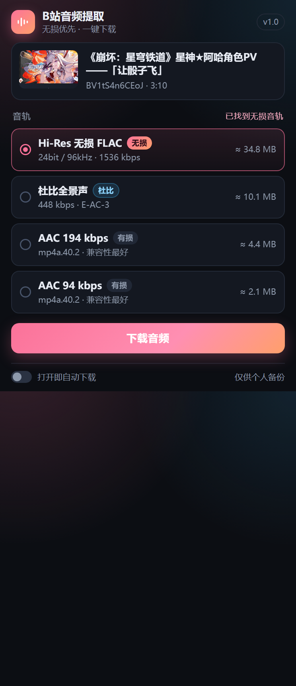

# B站音频提取器（bili-audio-grabber）

一个 Chrome / Edge 扩展（Manifest V3）：**在 B 站视频页点一下图标，自动提取当前视频的原始音频并下载**。

它抓的是 B 站 DASH 流里**最原始的那条音轨**——不是录屏、不是二次转码、不是把播放器的声音录下来。所以哪怕视频只有 AAC，拿到的也是 B 站上传时的原始音频流，音质天花板由这个视频本身决定，不会再掉一层。



---

## 一、先说清楚「无损」这件事

这一点很重要，否则一定会失望：

| 音轨类型 | 编码 | 是否真无损 | 谁能拿到 |
| --- | --- | --- | --- |
| Hi-Res 无损 | FLAC | ✅ 真无损 | 视频本身带 FLAC **且** 账号是大会员 |
| 杜比全景声 | E-AC-3 | ❌ 有损（但比 AAC 好） | 视频带杜比 **且** 账号有权限 |
| 普通音轨 | AAC-LC | ❌ 有损 | 所有人（192k / 132k / 64k 若干档） |

**B 站绝大多数视频只有 AAC**。这不是插件的问题，是平台上就没有无损源。插件能做的是：

1. 把**所有可用音轨都列出来**，按 FLAC → 杜比 → AAC 码率降序排列，每条都标了「无损 / 杜比 / 有损」和预估体积；
2. 默认选中第一条（也就是能拿到的最高音质），点下载就下它；
3. 如果这个视频确实没有无损，界面上会直说「无无损音轨 · 按码率排序」，不会骗你。

> 想要真正的无损 FLAC：找音乐区那些标注了「Hi-Res」的稿件，登录大会员账号，插件会自动把 `Hi-Res 无损 FLAC` 排在第一行。

---

## 二、安装（未打包扩展）

1. 打开 `chrome://extensions/`（Edge 是 `edge://extensions/`）
2. 右上角打开 **开发者模式**
3. 点 **加载已解压的扩展程序**，选择本目录 `bili-audio-grabber`
4. 建议把图标固定到工具栏

要求 Chrome / Edge **102 或更高**（用到了 `chrome.scripting` 的 `world: "MAIN"`）。

---

## 三、使用

1. 打开任意 B 站视频播放页（`/video/BV...`、`/bangumi/play/ep...`、带 `?bvid=` 的列表页都行）
2. 点扩展图标
3. 弹出面板里会显示封面、标题、BV 号 / 分 P、时长，以及**可选音轨列表**
4. 默认开启「打开即自动下载」——面板一打开就开始下载最高音质那条；也可以关掉开关，手动挑一条再点「下载音频」

下载过程中面板显示进度条、已下载 / 总大小和实时速度，可以点「取消下载」。**弹窗关掉再打开，进度会接着显示**（状态存在页面里，不会因为关面板而中断）。下载完成后按钮变成「再下载一次」。

文件保存在浏览器默认下载目录，文件名形如：

```
【MV】某首歌 [BV1xx411c7mD FLAC].flac
某视频 - P2 第二集 [BV1xx411c7mD-P2 192k].m4a
```

---

## 四、它到底怎么工作的

```
popup（点一下）
  │  chrome.scripting.executeScript 注入
  ▼
grabber.js（在 bilibili.com 页面的隔离世界里跑）
  ├─ 1. 认视频：URL / __INITIAL_STATE__ → bvid·aid·cid·ep_id
  │      普通稿走 /x/web-interface/view，番剧走 /pgc/view/web/season
  ├─ 2. 取音轨：/x/player/wbi/playurl?fnval=4048
  │      fnval 里带 2048(FLAC) 256(杜比) 16(DASH)，才能问出无损
  │      wbi 签名 = 参数排序 + 去 !'()* + md5(query + mixinKey)
  │      （mixinKey 由 /x/web-interface/nav 的 wbi_img 拼表得到，缓存 10 分钟）
  ├─ 3. 解析：dash.flac / dash.dolby.audio / dash.audio 全部收下
  ├─ 4. 下载：fetch 流式读 → Blob → <a download> 触发保存
  │      content-length 拿总大小，边读边回报进度
  └─ 5. 嗅探真实容器：fLaC→.flac / ftyp→.m4a / ID3|0xFFEx→.mp3 / OggS→.ogg
```

几个刻意的设计选择，都有原因：

- **请求必须在页面里发，不在 popup 里发。** popup 是 `chrome-extension://` 源，跨站请求不保证带上 `SESSDATA`（SameSite 限制），拿不到登录态就等于拿不到大会员音轨；放在页面隔离世界里，`fetch(..., {credentials:'include'})` 天然就是这个站的登录身份。
- **必须走 wbi 签名端点。** 老接口 `/x/player/playurl` 返回的音轨列表被裁剪过，问不出 FLAC / 杜比。签名端点拒绝了会自动退回老端点，保证至少还能下 AAC。
- **下载用页面 fetch + Blob，而不是 `chrome.downloads`。** content script 本来就调不了 `chrome.downloads`；而页面 fetch 带的 `Referer` 是对的，还省掉了 offscreen + declarativeNetRequest 那一整套。实测 B 站 CDN 对 `Referer` 并不校验、且返回 `access-control-allow-origin: *`，所以这条路是通的。
- **状态机放在页面里。** `idle → preparing → ready → downloading → done / error` 全在 `grabber.js` 的闭包里，popup 每 500ms 轮询一次快照。所以关掉弹窗不打断下载，重开还能接着看进度。

---

## 五、权限说明

| 权限 | 为什么需要 |
| --- | --- |
| `activeTab` | 只在你点图标的那个标签页上执行，不做常驻注入 |
| `scripting` | 注入 `grabber.js`，以及在主世界读 `__INITIAL_STATE__` 兜底 |
| `storage` | 记住「打开即自动下载」这个开关 |
| `host_permissions: *://*.bilibili.com/*` | 调 `api.bilibili.com` 取音轨地址 |

没有后台 service worker，没有常驻脚本，不往任何第三方服务器发数据。

---

## 六、常见问题

**Q：为什么列表里没有「无损」？**
这个视频本身没有 FLAC 音轨，或者当前账号不是大会员。B 站的无损不是全站都有的。

**Q：我明明是大会员，还是没有 FLAC？**
先确认这个稿件确实带了 Hi-Res（音乐区部分稿件才有）；另外要在**这个页面里**已经登录（用插件前刷一下页面，让登录态生效）。

**Q：下来的 FLAC 文件名是 `.m4a`，是不是搞错了？**
没搞错。B 站的 FLAC 经常是 **MP4 封装的 FLAC**（音频头是 `ftyp`，不是 `fLaC`），所以按真实容器命名成 `.m4a` 才能正常播放。想转成标准 FLAC：

```bash
ffmpeg -i input.m4a -c copy output.flac
```

纯粹换封装，不重新编码，音质零损失。面板上也会提示这一点。

**Q：点下载没反应 / 提示无法与页面通信？**
刷新 B 站页面再点一次。刚装好扩展时，已经打开的旧标签页里还没有注入脚本，需要刷新。

**Q：直播、互动视频、课程能下吗？**
不能。直播是 FLV/TS 流不是 DASH；互动视频和课程走的是另一套接口。插件会直接告诉你「没有 DASH 音轨」。

**Q：多 P 视频下的是哪一 P？**
当前正在播的那一 P（面板上会显示 `· P2`）。

**Q：在合集里选了下一个视频，点开插件显示的还是上一条？（v1.1 已修）**
B 站换合集视频、换分 P 都是**页面内跳转**（`history.pushState`，页面不重载），所以注入的脚本会一直留在页面里，带着上一条视频的状态。
v1.1 起每份状态都记着「自己属于哪一条视频」（地址栏里的 BV / ep / 分 P 号）：页面一换就把旧状态整个作废、重新解析，点开插件看到的、下载到的都是当前这一条。万一状态没跟上（比如解析途中又切了视频），下载请求会被直接拒绝并提示「页面里的视频已经换了」，不会下错文件。
升级方式：`chrome://extensions` 里点这个扩展的「重新加载」按钮。

**Q：下载很慢 / 中途失败？**
音轨地址是有时效的签名 CDN 链接，过期会 403。插件会自动换 `backupUrl` 重试；全都失败就刷新页面重来。

**Q：会二次压缩吗？**
不会。字节原样落盘，连容器都不动。

---

## 七、开发与自测

```bash
node tools/selftest.mjs          # 纯逻辑自测（45 项，不需要网络）
node tools/selftest.mjs --live   # 顺带走一遍真实接口
node tools/e2e.mjs [URL]         # 端到端干跑：真接口 + 假 DOM，走完解析到落盘
node tools/e2e-switch.mjs        # 回归：同一页面里换视频后必须解析/下载到新的那一条
node --experimental-websocket tools/browser-grab.mjs [URL]
                                 # 真 Chrome 页面里跑 grabber.js（真 CORS、真 <a download> 落盘）
node tools/probe-cdn.mjs         # 实测 CDN 的 Referer / content-length / 容器头
node tools/probe-cors.mjs        # 实测 CDN 是否允许页面跨域读取
node tools/probe-flac.mjs        # 扫音乐区热门，看匿名能问到哪些音轨
python tools/make_icons.py       # 重新生成图标
```

`selftest.mjs` 用 `node:vm` 把 `grabber.js` 加载进一个假 `window` + 假 `chrome`，覆盖：MD5（对 `node:crypto` 逐字节比对）、wbi mixinKey（对官方已知值）、`buildQuery` 签名、`parseTracks`（全音轨 / 仅 AAC 两种输入）、`unwrapPlayurl`（三种返回形状 / 试看）、文件名清洗（含分 P 去重）、容器嗅探、换视频后旧状态作废（合集 / 分 P / 下载中不清）。

`tools/preview.html?state=ready|lossy|downloading|done|error|unsupported` 用假数据直接预览弹窗各状态，方便改样式：

```bash
chrome --headless=new --allow-file-access-from-files --force-device-scale-factor=2 \
       --window-size=372,860 --screenshot=shot.png "file:///…/tools/preview.html?state=ready"
```

注意 Chrome 137 起 `--load-extension` 命令行开关已被禁用，`tools/browser-test.mjs`（直接以扩展形态跑弹窗）在官方 Chrome 上会加载失败——手动「加载已解压的扩展程序」不受影响；`browser-grab.mjs` 不依赖扩展加载，所以仍然可用。

目录：

```
bili-audio-grabber/
├── manifest.json        MV3 清单
├── grabber.js           页面执行器：取音轨 + 下载 + 状态机
├── popup.html/css/js    弹窗界面
├── icons/               16 / 32 / 48 / 128 / 512
├── docs/                界面截图
└── tools/               自测与探针脚本（不参与打包）
```

---

## 八、注意

仅供**个人离线备份**自己有权观看的内容使用。下载的音轨版权归原作者与平台，请勿二次分发或商用；批量抓取可能触发风控并违反平台用户协议。使用者自行承担后果。
